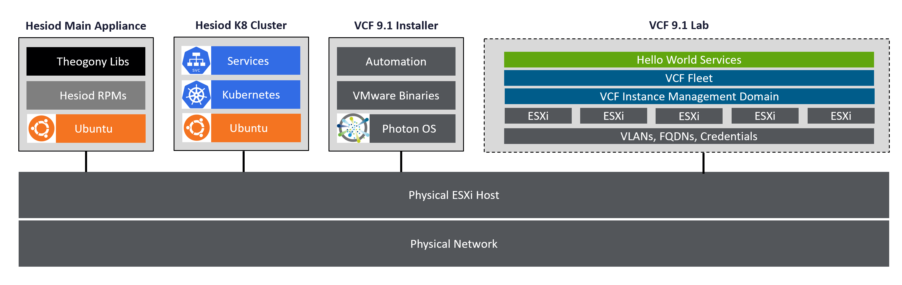

# Hesiod Theogony
   
**Theogony** is an ancient Greek poem by Hesiod that details the origins of the gods, the creation of the universe, and serves as a foundational text for Greek Mythology. As such the contents of this repository represent the foundational codebase for a VMware based home lab. 

# Prerequisites
* At least one physical server running ESXi 9.
* A router (virtual or physical) where you can create subnets and BGP peering.
* Appropriate access and entitlements to Broadcom software.
* Open source Ubuntu ISO.

# Architecture Summary


# Getting Started: Deploy a Hesiod Main Appliance
The `Hesiod Main` appliance is the primary orchestrator for the modules below. Each module corresponds to a critical capability needed to run a VMware home lab. Jump access to and from the home lab (VPN, RDP, etc) is out of scope for this project. Start by deploying an Ubuntu server to your physical ESXi host using an open source ISO. Ensure OpenSSH is enabled. Once deployed, SSH into the Ubuntu Server and run the following **in order** to initialize the `hesiod-theogony` orchestrator.

Download the `prep-ubuntu` bash script. 
```
sudo curl https://raw.githubusercontent.com/boconnor2017/hesiod-theogony/refs/heads/main/ubuntu/prep-ubuntu.sh >> prep-ubuntu.sh
```

Run the `prep-ubuntu` bash script.
```
sudo sh prep-ubuntu.sh
```

Navigate to `/usr/local/hesiod-theogony` working directory.
```
cd /usr/local/hesiod-theogony
```

Run `hesiod-theogony` python script using the `-init` parameter. This will initialize the Theogony modules below with necessary python packages.
```
sudo python3 hesiod-theogony.py -init
```   

You have now deployed the **Hesiod Main Appliance**. Run `sudo python3 hesiod-theogony.py --help` for details on CLI commands. Use this program to orchestrate the modules below.

# Modules: Deploy a VMware Lab Environment
Using the **Hesiod Main Appliance**, select from the list of modules below and pass parameters accordingly. The source of all configuration details is a file called `lab_spec.json` that is stored in the `conf/` folder. **WARNING: Do not edit or remove any of the files in /json_lib. These are to be COPIED only. Do not edit or remove any of the files in /conf other than lab_spec.json. The files in /conf are used as a configuration database for the modules below.**

| Module   | Description                   |
|----------|-------------------------------|
| Module 01 | Create a `lab_spec.json` file |
| Module 02 | Deploy Kubernetes (K8) |
| Module 03 | Deploy DNS Server on K8 |
| Module 04 | Create DNS Zone and FQDNs for VCF |
| Module 05 | Deploy LDAP Server on K8 |
| Module 06 | Create LDAP Groups and Users for VCF |
| Module 07 MGT | Deploy Nested ESXi Hosts (Management) |
| Module 08 | Deploy VCF Fleet Management Domain |
| Module 09 | Deploy CyberArk Conjur OSS Server on K8 |
| Module 10 | Deploy Certificate Authority on K8 and Rotate VCF Certificates |
| Module 11 | Deploy SFTP Server on K8 and Configure VCF Backups |
| Module 12 | Deploy KMS Server on K8 and Encrypt vSAN Management Cluster |
| Module 13 | Audit the Management Domain against VCF Security Compliance Guide |
| Module 07 VI | Deploy Nested ESXi Hosts (VI) |
| Module 14 | Deploy a VI Workload Domain |
| Module 15 | Deploy an Edge and a Hello World VPC with BGP |
| Module 16 | Deploy Log Management and Realtime Metrics |
| Module 17 | Deploy VCF Operations for Networks |
| Module 18 | Deploy VKS |


## Module 1: Create a Lab Spec JSON file
| Prerequisite | Comments                                     |
|--------------|----------------------------------------------|
| Getting Started | Hesiod Main Appiance needs to be deployed.|

### Manual Process
Use the instructions from [lab_spec.json Instructions](https://github.com/boconnor2017/hesiod-theogony/blob/main/docs/json_lib.md) to create your first `conf/lab_spec.json` file. 

### Prompted/Automated Process
*Coming Soon: a CLI prompt questionnaire to help you create your first conf/lab_spec.json configuration file.*
```
sudo python3 hesiod-theogony.py -m1
```  

## Module 2: Deploy Hesiod Kubernetes Services (HKS)
| Prerequisite | Comments                                     |
|--------------|----------------------------------------------|
| Module 1     | `/conf/lab_spec.json` needs to be populated. |

The Hesiod Kubernetes Services are used to host shared services (DNS, LDAP, Password Vault, CA, KMS, etc) for your nested VCF environment. External services include: DNS, LDAPS, offline depots, etc. This script uses the configuration from `lab_spec.json` to deploy Kubernetes on Ubuntu. 
```
sudo python3 hesiod-theogony.py -m2
```  

## Module 3: Deploy Technitium DNS Server
| Prerequisite | Comments                                     |
|--------------|----------------------------------------------|
| Module 1     | `/conf/lab_spec.json` needs to be populated. |
| Module 2     | HKS needs to be running.                     |

This script uses the configuration from `lab_spec.json` in Module 1 to deploy a Technitium Server pod on the HKS cluster from Module 2. 
```
sudo python3 hesiod-theogony.py -m3
```    
You can connect to your Technitium DNS server at `http://<DNS Server IP Address>:5380`

## Module 4: Create DNS Zone and FQDNs for VCF
| Prerequisite | Comments                                     |
|--------------|----------------------------------------------|
| Module 1     | `/conf/lab_spec.json` needs to be populated. |
| Module 2     | HKS needs to be running.                     |
| Module 3     | Technitium needs to be running and availble. |

This script uses the configuration from `lab_spec.json` in Module 1 to create a DNS zone on the Technitium server deployed in Module 3. You can run this script as many times as you like. Each time the zone and the previous FQDNs will be repaved with the most up to date values from `/conf/lab_spec.json`. 
```
sudo python3 hesiod-theogony.py -m4
```   

## Module 5: Deploy LLDAP Server
| Prerequisite | Comments                                     |
|--------------|----------------------------------------------|
| Module 1     | `/conf/lab_spec.json` needs to be populated. |
| Module 2     | HKS needs to be running.                     |

This script uses the configuration from `lab_spec.json` in Module 1 to deploy a LLDAP Server pod on the HKS cluster from Module 2. You can run this script as many times as you like. Each time the LLDAP Server will be redeployed on HKS. 
```
sudo python3 hesiod-theogony.py -m5
```   

## Module 6: Create LDAP Groups and Users
| Prerequisite | Comments                                     |
|--------------|----------------------------------------------|
| Module 1     | `/conf/lab_spec.json` needs to be populated. |
| Module 2     | HKS needs to be running.                     |
| Module 5     | LLDAP needs to be running and available.      |

This script uses the configuration from `lab_spec.json` in Module 1 to create LDAP Groups and LDAP Users on the LLDAP server deployed in Module 5. You can run this script as many times as you like. Each time the AD Groups and Users will be repaved with the most up to date values from `/conf/lab_spec.json`. 
```
sudo python3 hesiod-theogony.py -m6
```  

## Module 7: Deploy Nested ESXi Hosts
| Prerequisite | Comments                                     |
|--------------|----------------------------------------------|
| ESXi ISO     | The ESXi ISO needs to be uploaded to a datastore on your physical host. |
| Module 1     | `/conf/lab_spec.json` needs to be populated. |
| Module 2     | HKS needs to be running.                     |
| Module 3     | Technitium needs to be running and availble. |
| Module 4     | DNS Entries need to be completed.            |

This script uses the configuration from `lab_spec.json` in Module 1 to build a group of VCF-Ready nested ESXi hosts using the ESXi ISO. Run the following **AFTER you have uploaded the ESXi ISO to a datastore on the Physical Server**. Use additional parameters `MGT` to build management servers, `VI` to build workload servers, and `--replace` to replace existing servers with a new configuration in `/conf/lab_spec.json`.

```
sudo python3 hesiod-theogony.py -m7 MGT
```  

To deploy nested hosts for VI, run the following.
```
sudo python3 hesiod-theogony.py -m7 VI
```  

To replace existing management hosts, run the following.
```
sudo python3 hesiod-theogony.py -m7 MGT --replace
```  
To replace existing management hosts, run the following.
```
sudo python3 hesiod-theogony.py -m7 VI --replace
```  

## Module 8: Deploy VCF Fleet Management Domain
| Prerequisite | Comments                                     |
|--------------|----------------------------------------------|
| Module 1     | `/conf/lab_spec.json` needs to be populated. |
| Module 2     | HKS needs to be running.                     |
| Module 3     | Technitium needs to be running and availble. |
| Module 4     | DNS Entries need to be completed.            |
| Module 5     | LLDAP needs to be running and available.     |
| Module 6     | LDAP Users and Groups need to be completed.  |
| Module 7 (MGT) | Nested ESXi hosts (recommended: 5) need to be deployed.  |

This script uses the configuration from `lab_spec.json` in Module 1 to deploy a VCF Fleet. Run the following **AFTER you have manually deployed the VCF Installer**. Use additional parameters `--deploy` to run the installation or `--retry` to continue an installation after a failure. Without these parameters this module will stop at the precheck. Detailed results of the precheck are stored in `/conf/vcf_management_domain_validation.json`. *Note: its normal for this process to take several hours.*

Precheck only.
```
sudo python3 hesiod-theogony.py -m8
``` 

Run the installer and deploy the VCF Fleet Management Domain.
```
sudo python3 hesiod-theogony.py -m8 --deploy
``` 

Retry after a failure.
```
sudo python3 hesiod-theogony.py -m8 --retry
``` 

Check on status. 
```
sudo python3 hesiod-theogony.py -m8 --status
``` 

## Module 9: Deploy a CyberArk Conjur OSS Server on HKS
| Prerequisite | Comments                                     |
|--------------|----------------------------------------------|
| Module 1     | `/conf/lab_spec.json` needs to be populated. |
| Module 2     | HKS needs to be running.                     |
| Module 8     | VCF Fleet is deployed.                       |

This script uses the configuration from `lab_spec.json` in Module 1 to build a `conjur-oss` kubernetes pod on HKS from Module 2. This script will automatically query the SDDC Manager from Module 8, will pull passwords, and will store them in the password vault. Use additional parameters `--report` to generate a markdown file containing readiness of the password vault and available passwords.

Deploy Conjur, query SDDC Manager, store passwords in vault.
```
sudo python3 hesiod-theogony.py -m9
``` 

Generate a markdown file showing readiness of the password vault and secrets.
```
sudo python3 hesiod-theogony.py -m9 --report
``` 

## Module 10: Deploy a Certificate Authority and Rotate Certs
| Prerequisite | Comments                                     |
|--------------|----------------------------------------------|
| Module 1     | `/conf/lab_spec.json` needs to be populated. |
| Module 2     | HKS needs to be running.                     |
| Module 8     | VCF Fleet is deployed.                       |

This script uses the configuration from `lab_spec.json` in Module 1 to build a `step-ca` Kubernetes pod on HKS from Module 2 and rotates certificates using SDDC Manager from Module 8. **IMPORTANT: Run each script below in the following order and ensure results are successful before proceeding to the next.**

Deploy Certificate Authority
```
sudo python3 hesiod-theogony.py -m10
``` 
Generate CSRs and Keys and ask SDDC Manager to validate them
```
sudo python3 hesiod-theogony.py -m10 --rotate --dry-run
``` 
Rotate certificates for all VCF components
```
sudo python3 hesiod-theogony.py -m10 --rotate
``` 
Generate a markdown file showing readiness of the certificate rotation process.
```
sudo python3 hesiod-theogony.py -m10 --report
``` 

## Module 11: Deploy an SFTP Server and Configure Backups
| Prerequisite | Comments                                     |
|--------------|----------------------------------------------|
| Module 1     | `/conf/lab_spec.json` needs to be populated. |
| Module 2     | HKS needs to be running.                     |
| Module 8     | VCF Fleet is deployed.                       |

This script uses the configuration from `lab_spec.json` in Module 1 to build a lightweight `sftp` Kubernetes pod on HKS from Module 2 and configures backups for components deployed in Module 8. **IMPORTANT: Run each script below in the following order and ensure results are successful before proceeding to the next.**

Deploy SFTP server.
```
sudo python3 hesiod-theogony.py -m11
``` 
Asks SDDC Manager and vCenter to validate the backup settings. Nothing is saved.
```
sudo python3 hesiod-theogony.py -m11 --configure --dry-run
``` 
Saves the backup settings in SDDC Manager, which also passes them to NSX, and in vCenter.
```
sudo python3 hesiod-theogony.py -m11 --configure
``` 
Runs a manual backup of SDDC Manager, NSX, and vCenter, and waits for each.
```
sudo python3 hesiod-theogony.py -m11 --backup-now
``` 
Generate a markdown file showing readiness of the backup process.
```
sudo python3 hesiod-theogony.py -m11 --report
``` 

## Module 12: Deploy a KMS Server and Encrypt vSAN
| Prerequisite | Comments                                     |
|--------------|----------------------------------------------|
| Module 1     | `/conf/lab_spec.json` needs to be populated. |
| Module 2     | HKS needs to be running.                     |
| Module 8     | VCF Fleet is deployed.                       |
| Module 9     | Password Vault is configured and available.  |

This script uses the configuration from `lab_spec.json` in Module 1 to build a Key Management Server Kubernetes pod on HKS from Module 2 and configures data in motion and data at rest encryption on vSAN clusters deployed in Module 8. Secrets are stored in the password vault from Module 9. **IMPORTANT: Run each script below in the following order and ensure results are successful before proceeding to the next.**

Deploy KMS server.
```
sudo python3 hesiod-theogony.py -m12
``` 
Registers KMS in vCenter as a key provider called kms-mpc and sets up trust both ways. Then it checks the provider shows green and generates a test key through vCenter.
```
sudo python3 hesiod-theogony.py -m12 --configure
``` 
Turns on vSAN data-in-transit encryption only, with no reformat.
```
sudo python3 hesiod-theogony.py -m12 --in-transit-only
``` 
Turns on vSAN data-at-rest encryption with kms-mpc, plus in-transit if it isn’t on yet.
```
sudo python3 hesiod-theogony.py -m12 --encrypt-vsan
``` 
(Optional) Copies the key database to conf/kmip/ and to the SFTP backup target from Module 11.
```
sudo python3 hesiod-theogony.py -m12 --backup-keys
``` 
Generate a markdown file showing readiness of vSAN Encryption.
```
sudo python3 hesiod-theogony.py -m12 --report
``` 

## Module 13: Audit the Management Domain against the VCF 9.1 Security Compliance Guide
| Prerequisite | Comments                                     |
|--------------|----------------------------------------------|
| Module 1     | `/conf/lab_spec.json` needs to be populated. |
| Module 2     | HKS needs to be running.                     |
| Module 8     | VCF Fleet is deployed.                       |

This script uses the configuration from `lab_spec.json` in Module 1 to access the VCF Fleet deployed in Module 8 and performs a series of PowerCLI checks against [Broadcom's VCF 9.1 Security and Compliance Guide (Github)](https://github.com/vmware/vcf-security-and-compliance-guidelines) which is based on [Broadcom's VCF 9.1 Security and Compliance Guide (TechDocs)](https://techdocs.broadcom.com/us/en/vmware-cis/vcf/vcf-9-0-and-later/9-1/security-and-compliance.html). Use additional parameters `--setup` to install PowerShell prerequisites on the Hesiod Main Appliance, `--report` to build a markdown report from the last audit, and `--remediate` to programatically configure the VCF Fleet so it meets compliance thresholds. **IMPORTANT: making changes to the environment according to the SCG can be destructive!! Make sure you fully understand the guidance in the SCG before proceeding.** To protect against destructive tasks that could impact your nested lab environment, a series of DEFCON levels (see below) have been created. The following scripts assume a default `DEFCON LEVEL 5`. To make more impactful changes you will have to explicitly pass the DEFCON level into the command line.  

Install PowerShell and other prerequsites needed for the audit.
```
sudo python3 hesiod-theogony.py -m13 --setup
``` 
Runs the audit.
```
sudo python3 hesiod-theogony.py -m13
``` 
Builds a report against the last audit.
```
sudo python3 hesiod-theogony.py -m13 --report
``` 
Makes necessary changes to VCF Fleet to remediate audit failures (Default: DEFCON LEVEL 5)
```
sudo python3 hesiod-theogony.py -m13 --remediate
``` 


### DEFCON LEVELS
| DEFCON LEVEL | DEFCON DESCRIPTION                  | RISK             |
|--------------|-------------------------------------|------------------|
| DEFCON 5     | Changes settings and policies only. | Safest (default) |
| DEFCON 4     | Adds service/feature state.         | Low              |
| DEFCON 3     | Adds VM power cycles and switch security. | Medium     |
| DEFCON 2     | Adds lock-out risks.                | High             |
| DEFCON 1     | Adds reboots and TLS cut-over.      | Critical         |

Makes necessary changes to VCF Fleet to remediate audit failures with the specified DEFCON LEVEL.
```
sudo python3 hesiod-theogony.py -m13 --defcon N --remediate
``` 

## Module 14: Deploy a VI Workload Domain
| Prerequisite | Comments                                     |
|--------------|----------------------------------------------|
| Module 1     | `/conf/lab_spec.json` needs to be populated. |
| Module 2     | HKS needs to be running.                     |
| Module 3     | Technitium needs to be running and availble. |
| Module 4     | DNS Entries need to be completed.            |
| Module 5     | LLDAP needs to be running and available.     |
| Module 6     | LDAP Users and Groups need to be completed.  |
| Module 7 (VI) | Nested ESXi hosts (recommended: 4) are deployed.  |
| Module 8     | VCF Fleet is deployed.                       |
| Module 9     | Password Vault is deployed and available.    |
| Module 10    | Certificate Authority is deployed and available. |
| Module 11    | SFTP backup server is deployed and available.|
| Module 12    | KMS Server is deployed and available.        |

This script uses the configuration from `lab_spec.json` in Module 1 to access the VCF Fleet deployed in Module 8 and build a VI workload domain. Integrations to all shared services running on HKS from Module 2 (DNS, LDAP, Password Vault, CA, SFTP, etc) are automatically included. **IMPORTANT: Run each script below in the following order and ensure results are successful before proceeding to the next.** 

Creates network pool and commissions the VI hosts in SDDC Manager.
```
sudo python3 hesiod-theogony.py -m14 --commission
``` 
Validates the hosts via SDDC Manager.
```
sudo python3 hesiod-theogony.py -m14 --validate
``` 
Builds the VI workload domain using the verified hosts.
```
sudo python3 hesiod-theogony.py -m14 --deploy
``` 
Retry the build of the VI workload domain using the verified hosts after a failure.
```
sudo python3 hesiod-theogony.py -m14 --retry
``` 
Check the status of the workload domain.
```
sudo python3 hesiod-theogony.py -m14 --status
``` 
Build a markdown file with a report on the workload domain deployment.
```
sudo python3 hesiod-theogony.py -m14 --report
``` 

### Extend Certificates and Backups to the New Workload Domain
Extends certificates to the new workload domain (Dry run is a validation, non impactful)
```
sudo python3 hesiod-theogony.py -m14 --certs --dry-run
``` 
Extends certificates to the new workload domain, rotates accordingly
```
sudo python3 hesiod-theogony.py -m14 --certs
``` 
Extends backups to the new workload domain
```
sudo python3 hesiod-theogony.py -m14 --backups --backup-now
``` 

## Module 15: Deploy an Edge and a VPC with BGP
| Prerequisite | Comments                                     |
|--------------|----------------------------------------------|
| Getting Started | Router BGP settings need to be verified.  |
| Module 1     | `/conf/lab_spec.json` needs to be populated. |
| Module 2     | HKS needs to be running.                     |
| Module 3     | Technitium needs to be running and availble. |
| Module 7 (VI) | Nested ESXi hosts (recommended: 4) are deployed.  |
| Module 8     | VCF Fleet is deployed.                       |
| Module 14    | VCF VI workload domain is deployed.          |

This script uses the configuration from `lab_spec.json` in Module 1 to access the VCF Fleet deployed in Module 8 and build a VPC on the VI workload domain deployed in Module 14. Use parameters `EDGE` to deploy the necessary VCF Networking Edge infrastructure, and `VPC` to deploy the VPC itself. Each option has additional parameters as specified below. **IMPORTANT: Run each script below in the following order and ensure results are successful before proceeding to the next.**

Shows the deployment plan and checks the prerequisites.
```
sudo python3 hesiod-theogony.py -m15 EDGE
``` 

Prints what your lab router needs: per uplink VLAN, its IP, the two edge neighbors, remote AS, 60/180 timers and BFD. It also prints an FRR example. Your router should send only a default route and accept the VPC external block.
```
sudo python3 hesiod-theogony.py -m15 EDGE --router-config
``` 

Deploys the necessary VCF Networking Edge infrastructure for the VPC.
```
sudo python3 hesiod-theogony.py -m15 EDGE --deploy
``` 

Validates the edges.
```
sudo python3 hesiod-theogony.py -m15 EDGE --report
``` 

Shows the plan and checks the Tier-0, transit gateway and default VPC connectivity profile exist, BGP is up, and the Ubuntu OVA is there.
```
sudo python3 hesiod-theogony.py -m15 VPC
``` 

Deploys the VPC.
```
sudo python3 hesiod-theogony.py -m15 VPC --deploy
``` 

Builds two Ubuntu VMs from the same cloud-image OVA as your other Ubuntu servers, one per subnet. It runs curl https://dl.broadcom.com inside the private VM through VMware Tools, since that VM has no inbound route. It pings the public VM from hesthe001, which plays jump01. It runs vmkping ++netstack=vxlan -d -s 8972 from every host TEP to every other host and edge TEP.
```
sudo python3 hesiod-theogony.py -m15 VPC --hello-world
``` 

Validates the VPC.
```
sudo python3 hesiod-theogony.py -m15 EDGE --report
``` 

## Module 16: Deploy Log Management and Realtime Metrics
| Prerequisite | Comments                                     |
|--------------|----------------------------------------------|
| Getting Started | All necessary downloads (including download tool) need to be available |
| Module 1     | `/conf/lab_spec.json` needs to be populated. |
| Module 2     | HKS needs to be running.                     |
| Module 3     | Technitium needs to be running and availble. |
| Module 8     | VCF Fleet is deployed.                       |

This script uses the configuration from `lab_spec.json` in Module 1 to access the VCF Fleet deployed in Module 8 and deploy Log Management `LOG` and Realtime Metrics `RTM`. Each option has additional parameters as specified below.

Runs a plan for Log Management.
```
sudo python3 hesiod-theogony.py -m16 LOG
```

Deploys Log Management.
```
sudo python3 hesiod-theogony.py -m16 LOG --deploy
```

Validates Log Management.
```
sudo python3 hesiod-theogony.py -m16 LOG --report
```

Runs a plan for Realtime Metrics.
```
sudo python3 hesiod-theogony.py -m16 RTM
```

Deploys Realtime Metrics.
```
sudo python3 hesiod-theogony.py -m16 RTM --deploy
```

Validates Realtime Metrics.
```
sudo python3 hesiod-theogony.py -m16 RTM --report
```

Configures 2-second ESX collection, 30-day retention, log forwarding, and email alerts
```
sudo python3 hesiod-theogony.py -m16 --configure
```

## Module 17: Deploy VCF Operations for Networks
`Coming Soon.`

## Module 18: Deploy and Configure VKS Supervisor and VPC
| Prerequisite | Comments                                     |
|--------------|----------------------------------------------|
| Module 1     | `/conf/lab_spec.json` needs to be populated. |
| Module 2     | HKS needs to be running.                     |
| Module 3     | Technitium needs to be running and availble. |
| Module 8     | VCF Fleet is deployed.                       |
| Module 10    | CA server needs to be running and available. |
| Module 14    | VCF VI workload domain is deployed.          |

This script uses the configuration from `lab_spec.json` in Module 1 to deploy a VKS Supervisor and a VPC to the workload domain from Module 14. The `SPV` parameter deploys the Supervisor and creates the NSX foundation for the VPC. The `VPC` parameter creates the namespace on the VPC and a "Hello World" workload (deployment with a load balancer).

Runs a plan for the VKS Supervisor.
```
sudo python3 hesiod-theogony.py -m18 SPV
```

Depoloys the VKS Supervisor.
```
sudo python3 hesiod-theogony.py -m18 SPV --deploy
```