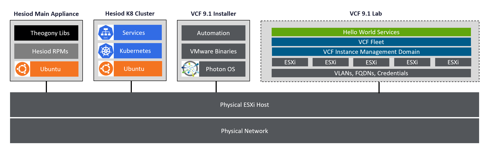

# Hesiod Theogony
   
This is a branch from Project Hesiod: https://github.com/boconnor2017/hesiod. **Theogony** is an ancient Greek poem by Hesiod that details the origins of the gods, the creation of the universe, and serves as a foundational text for Greek Mythology. As such the contents of this repository represent the foundational codebase for a VMware based home lab. 

# Prerequisites
* At least one physical server running ESXi 9
* A router (virtual or physical) where you can create subnets and BGP peering
* Appropriate access and entitlements to Broadcom software

| Module         | Prerequisite                     | Resource Requirements         |
|----------------|----------------------------------|-------------------------------|
| Quick Start    | 1x Physical server and 1x Subnet | (see physical server specs below) | 
| Module 1       | (Same as Quick Start)            | (see virtual server specs below)  |
| Module 2       | (Same as Quick Start)            | (see virtual server specs below)  |
| Module 3       | (Same as Quick Start)            | (see virtual server specs below)  |
| Module 4       | (Same as Quick Start)            | (see virtual server specs below)  |
| Module 5       | (Same as Quick Start)            | (see virtual server specs below)  |
| Module 6       | (Same as Quick Start)            | (see virtual server specs below)  |
| Module 7       | VCF 9.1.1 binaries from Broadcom | (see Broadcom specs below)  |

## Physical Server Specs


## Virtual Server Specs
| Component                | vCPU | vMemory (GB) | vStorage (GB) |
|--------------------------|------|--------------|---------------|
| Hesiod Main Appliance    | 4    | 16           | 100           |
| Hesiod K8 Cluster Master | 4    | 16           | 100           |
| Hesiod K8 Cluster Node 1 | 4    | 16           | 100           |
| VCF Installer            | 4    | 16           | 914           |
| Nested ESXi Host 1       | 40   | 320          | 1080          |
| Nested ESXi Host 2       | 40   | 320          | 1080          |
| Nested ESXi Host 3       | 40   | 320          | 1080          |
| Nested ESXi Host 4       | 40   | 320          | 1080          |
| Nested ESXi Host 5       | 40   | 320          | 1080          |
| TOTAL:                   | 40   | 1664         | 6614          |

## Broadcom Specs
|Component            | Type | Module |
|---------------------|------|--------|
| ESXi 9.1.1          | ISO  | 7      |
| VCF 9.1.1 Installer | OVA  | 8      |

# Architecture Summary


# Quick Start: Deploy Hesiod Main Appliance
Step 1: Deploy Ubuntu 64-bit Server with OpenSSH enabled. Login to the OS with SSH.   

Step 2: Download the `prep-ubuntu` bash script. 
```
sudo curl https://raw.githubusercontent.com/boconnor2017/hesiod-theogony/refs/heads/main/ubuntu/prep-ubuntu.sh >> prep-ubuntu.sh
```

Step 3: Run the `prep-ubuntu` bash script.
```
sudo sh prep-ubuntu.sh
```

Step 4: Navigate to `/usr/local/hesiod-theogony` working directory.
```
cd /usr/local/hesiod-theogony
```

Step 5: Run `hesiod-theogony` python script using the `-init` parameter. This will initialize the Theogony modules below with necessary python packages.
```
sudo python3 hesiod-theogony.py -init
```   

You have now deployed the **Hesiod Main Appliance**. Run `sudo python3 hesiod-theogony.py --help` for details.

# Modules: Deploy a VMware Lab Environment
Using the **Hesiod Main Appliance**, select from the list of modules below and pass parameters accordingly.

## Module 1: Create Lab Spec JSON files (Coming Soon...)
The `lab_spec.json` file contains the specs for your home lab. Specs include physical network configurations, physical host configurations, storage configurations, credentials, etc. Blank json templates are stored in the `/json_lib` folder. This script will generate a copy and will prompt you for inputs. Configurations are stored in the `/conf` folder. If you prefer to generate your own json file, copy `/json_lib/lab_spec.json`, paste into `/conf/lab_spec.json` and edit directly using vi editor. Alternatively, if you've created one already, simply upload it to `/conf/lab_spec.json`.    

The `dns_spec.json` file contains the dns specs for a brand new DNS server that you can deploy as part of Module 3. Blank json templates are stored in the `/json_lib` folder. This script will generate a copy and will prompt you for inputs. Configurations are stored in the `/conf` folder. If you prefer to generate your own json file, copy `/json_lib/dns_spec.json`, paste into `/conf/dns_spec.json` and edit directly using vi editor. Alternatively, if you've created one already, simply upload it to `/conf/dns_spec.json`.    

**WARNING: Do not edit or remove any of the files in /json_lib. Copy only.**
```
sudo python3 hesiod-theogony.py -m1
```  

## Module 2: Deploy Hesiod Kubernetes Services (HKS)
The Hesiod Kubernetes Services are used to host external services needed to run your nested VCF environment. External services include: DNS, LDAPS, offline depots, etc. The Hesiod Main Appliance will interact with your physical ESXi host(s) using details from **Module 1** to build virtual machines running Ubuntu Servers with Kubernetes. 
```
sudo python3 hesiod-theogony.py -m2
```  

## Module 3: Deploy Technitium DNS Server
A DNS server is required for your VMware environment. This script uses the configuration from `lab_spec.json` in Module 1 to deploy a Technitium Server pod on the HKS cluster from Module 2. Specifically:
```
"domain" : {
        "name" : "<sample: hesiod.local>",
        "server_ips" : ["<sample: 10.0.1.9", "8.8.8.8"],
        "ntp" : "pool.ntp.org",
        "fqdns" : [{
            "naming_convention" : "<sample: hesvcf>",
            "assign_ip_from_this_network" : 1, 
            "assign_ip_from_this_range_start" : "9",
            "assign_ip_from_this_range_end" : "60"
        }]
    }
```
The first IP address in `assign_ip_from_this_range_start` is reserved for the Technitium DNS server. This IP address is used by MetalLb to expose the `server_ips`[0] IP address that differs from the Kubernetes node.  
```
sudo python3 hesiod-theogony.py -m3
```    
You can connect to your Technitium DNS server at http://<DNS Server IP Address>:5380

## Module 4: Create DNS Zone and FQDNs for VCF
This script uses the configuration from `lab_spec.json` in Module 1 to create a DNS zone on the Technitium server deployed in Module 3. Specifically:
```
"domain" : {
        "name" : "<sample: hesiod.local>",
        "server_ips" : ["<sample: 10.0.1.9", "8.8.8.8"],
        "ntp" : "pool.ntp.org",
        "fqdns" : [{
            "naming_convention" : "<sample: hesvcf>",
            "assign_ip_from_this_network" : 1, 
            "assign_ip_from_this_range_start" : "9",
            "assign_ip_from_this_range_end" : "60"
        }]
    }
```
The first IP address in `assign_ip_from_this_range_start` is reserved for the Technitium DNS server. This IP address is used by MetalLb to expose the `server_ips`[0] IP address that differs from the Kubernetes node. The remaining addresses in the range will be used for the FQDNs. The FQDN is generated automatically using the naming convention and appending a counter with the zone name. For example, in the example above the first FQDN would be `hesvcf01.hesiod.local`, the second `hesvcf02.hesiod.local` and so on until the last IP address from `assign_ip_from_this_range_end` has been assigned.    

You can run this script as many times as you like. Each time the zone and the previous FQDNs will be overwritten. 
```
sudo python3 hesiod-theogony.py -m4
```   

## Module 5: Deploy LLDAP Server
An LDAP server is recommended but not required for your VMware environment. This script uses the configuration from `lab_spec.json` in Module 1 to deploy a LLDAP Server pod on the HKS cluster from Module 2. Specifically:
```
"lldap" : {
        "hostname" : "<sample: ldap>",
        "ip_address" : "<sample: 10.0.1.8>",
        "use_these_credentials" : 0
    },

```


You can run this script as many times as you like. Each time the LLDAP Server will be redeployed on HKS. 
```
sudo python3 hesiod-theogony.py -m5
```   

## Module 6: Create LDAP Groups and Users
This script uses the configuration from `lab_spec.json` in Module 1 to create LDAP Groups and LDAP Users for your VMware environment.

```
"ldap" : {
    "groups" : [{
        "name" : "<sample: group_01>"
    }],
    "users" : [{
        "username" : "<sample: user_01>",
        "display_name" : "",
        "first_name" : "",
        "last_name" : "",
        "email" : "<sample: user_01@hesiod.local",
        "password" :"<sample: VMware123!>",
        "add_to_these_groups" : [0]
        }]
    }
```

You can run this script as many times as you like. Each time the AD Groups and Users will be overwritten in LLDAP. 
```
sudo python3 hesiod-theogony.py -m6
```  

## Module 7: Deploy Nested ESXi Hosts
This script uses the configuration from `lab_spec.json` in Module 1 to build a group of VCF-Ready nested ESXi hosts using the ESXi ISO. 
```
"nested_esxi_servers" : [{
        "nested_esxi_type" : "<Select: MGT|VI >",
        "deploy_this_many" : 5,
        "naming_convention" : "<Sample: hesvcf-esx>",
        "use_these_credentials" : 2,
        "assign_ip_from_this_network" : 1, 
        "assign_ip_from_this_range_start" : "20",
        "assign_ip_from_this_range_end" : "28",
        "management_vlan_id" : "<Sample: 1610 (0 = untagged)>",
        "mtu" : "9000",
        "numCPU" : "40",
        "expose_hw_virt_to_guest" : "yes",
        "allow_legacy_cpu" : "<Select: yes|no (yes for CPUs ESXi 9 lists as deprecated, e.g. Skylake)>",
        "memoryGB" : "320",
        "numNIC" : "2",
        "harddisks" : [{
            "storage_GB" : "60"
        },
        {
            "storage_GB" : "16"
        },
        {
            "storage_GB" : "1024"
        }],
        "CD_path" : "[datastore1] ISO/VMware-ESXi-9.1.iso",
        "deploy_to_this_physical_host" : 0,
        "deploy_to_this_network" : 0,
        "deploy_to_this_datastore" : 0
    }]
```


Run the following **AFTER you have uploaded the ESXi ISO to a datastore on the Physical Server**. Use additional parameters `MGT` to build management servers, `VI` to build workload servers, and `--replace` to replace existing servers.

```
sudo python3 hesiod-theogony.py -m7 MGT
```  

To deploy nested hosts for VI, run the following.
```
sudo python3 hesiod-theogony.py -m7 VI
```  

To replace existing hosts, run the following.
```
sudo python3 hesiod-theogony.py -m7 --replace
```  

## Module 8: Deploy VCF Fleet Management Domain
This script uses the configuration from `lab_spec.json` in Module 1 to build a VCF Fleet Management Domain. 
```
"vcf" : {
    "version" : "9.1.1.0",
    "use_these_credentials" : 4,
    "installer" : {
        "ip_address" : "<sample: 10.0.2.15 (between ubuntu_servers range_end and nested_esxi_servers range_start)>",
        "use_these_credentials" : 3
    },
    "networks" : {
        "management" : 1,
        "vm_management" : 1,
        "vmotion" : { "network" : 3, "range_start" : "10", "range_end" : "50" },
        "vsan" : { "network" : 3, "range_start" : "60", "range_end" : "100" },
        "host_tep" : { "network" : 3, "range_start" : "110", "range_end" : "150" }
    },
    "components" : [
        { "name" : "vcenter", "size" : "small" },
        { "name" : "sddc_manager" },
        { "name" : "nsx", "count" : 1, "size" : "medium" },
        { "name" : "vcf_operations", "count" : 1, "size" : "small" },
        { "name" : "vcf_operations_collector", "size" : "small" },
        { "name" : "vsp", "size" : "small", "pool_size" : 12 },
        { "name" : "vidb" },
        { "name" : "license_server" },
        { "name" : "fleet_lcm" },
        { "name" : "sddc_lcm" },
        { "name" : "vcf_automation", "size" : "small", "pool_size" : 5 }
    ],
    "cluster" : {
        "vsan_type" : "<Select: OSA|ESA>",
        "failures_to_tolerate" : 1,
        "vmnics" : ["vmnic0", "vmnic1"]
    },
    "naming_convention" : {
        "root" : "<sample: vcf>",
        "object" : [{
            "name" : "datacenter",
            "value" : "<sample: dc>"
        },
        {
            "name" : "management-cluster",
            "value" : "<sample: mcl>"
        },
        {
            "name" : "vi-cluster",
            "value" : "<sample: vcl>"
        }]
    }
}
```

Run the following **AFTER you have manually deployed the VCF Installer**. Use additional parameters `--deploy` to run the installation or `--retry` to continue an installation after a failure. Without these parameters this module will stop at the precheck. Detailed results of the precheck are stored in `/conf/vcf_management_domain_validation.json`.

Precheck.
```
sudo python3 hesiod-theogony.py -m8
``` 

Run the installer and deploy the VCF Fleet Management Domain.
```
sudo python3 hesiod-theogony.py -m8 --deploy
``` 

Retry after a failure.
```
sudo python3 hesiod-theogony.py -m8 --retry
``` 

Check on status. Note: its normal for this process to take several hours.
```
sudo python3 hesiod-theogony.py -m8 --status
``` 

## Module 9: Deploy a CyberArk Conjur OSS Server on HKS
This script uses the configuration from `lab_spec.json` in Module 1 to build a `conjur-oss` kubernetes pod on HKS from Module 2. This script will automatically query the SDDC Manager from Module 8, will pull passwords, and will store them in the password vault. 

```
"conjur" : {
    "hostname" : "<sample: conjur>",
    "ip_address" : "<sample: 10.0.1.7>",
    "account" : "<sample: hesiod>",
    "use_these_credentials" : 5,
    "node" : "<optional: HKS node that holds the vault database; delete this line to use the first Ready worker>",
    "data_path" : "/var/lib/hesiod/conjur/pgdata"
    }
```

Use additional parameters `--report` to generate a markdown file containing readiness of the password vault and available passwords.

Deploy Conjur, query SDDC Manager, store passwords in vault.
```
sudo python3 hesiod-theogony.py -m9
``` 

Generate a markdown file showing readiness of the password vault and secrets.
```
sudo python3 hesiod-theogony.py -m9 --report
``` 